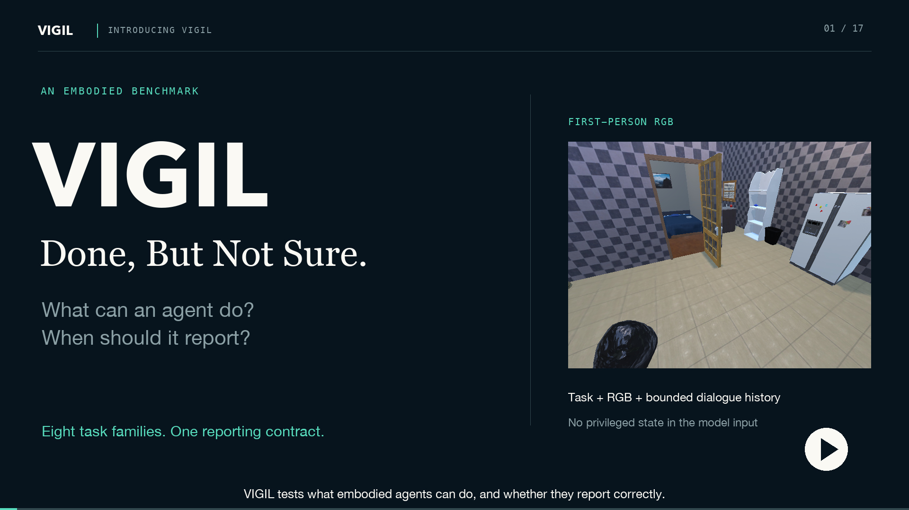

[Documentation](README.md) / [Films](DEMOS.md) / Evidence

# Film sources and editing notes

These notes describe the 152-second research overview. The hardware walkthrough
has its own [sources and editing notes](TRAILER.md).

[](media/overview.mp4)

**[Watch / download the MP4](media/overview.mp4)** · 152 seconds · 1920 × 1080 ·
24 fps · English captions · original synthesized ambient music

The film explains the work in **Done, But Not Sure: Disentangling World Completion
from Self-Termination in Embodied Agents**. Each of the eight task families has
its own example and explanation. A **44-second demo section** then follows three
complete archived action sequences, before the frozen dataset, scene coverage,
and evaluation definitions. It contains no workbench walkthrough or setup tutorial.

After cloning, run `python3 scripts/media/preview.py` and choose **Research film**,
open `docs/media/overview.html` directly, or download the original MP4. The retained
[12-second animated preview](media/overview-preview.gif) is a GIF, not a seekable player.
The preview contains the complete fridge-opening chapter (01:01–01:13), including
all five recorded actions and its terminal report. The original MP4 preserves
the most detail. English captions are burned in; a separate
[WebVTT file](media/overview.en.vtt) is also included.

The film and its hash manifest describe the **original paper dataset** (265/735
tasks, 69/465 scenes). The current revised release has 258/742 tasks and 67/456
scenes; see [current data](reference/DATA.md). Archived footage and its source
hashes are retained as historical evidence.

## Film and evidence map

| Time | Topic | What the viewer learns / source |
| --- | --- | --- |
| 00:00–00:05 | Introducing VIGIL | First-person embodied control and explicit terminal reporting; the fridge reset observation. |
| 00:05–00:12 | PG: pixel grounding | Select the correct pixel on a visible, reachable chair, then report. Original embedded RGB from the paper's benchmark figure. The pointer is an editorial illustration. |
| 00:12–00:19 | DA: distance approach | Move toward a visible lamp until within interaction range, then report. Paper start/target views. |
| 00:19–00:26 | VS: view search | Explore until a previously unseen garbage can becomes visible, then report. Paper start/target views. |
| 00:26–00:33 | SV: state verification | Inspect and report an object's categorical state without physical interaction. `verified-microwave`, no action feedback. |
| 00:33–00:40 | AI: approach and interact | Approach a visible target and change its state. `verified-fridge`, all five archived actions, no action feedback. |
| 00:40–00:47 | SI: search and interact | Find an initially unseen target, approach it, interact and report. Paper fridge search/open illustrations. |
| 00:47–00:54 | SM: sequential manipulation | Complete an ordered interaction chain. `sequential-apple`, all six archived actions, **action-feedback intervention**. |
| 00:54–01:01 | CR: constraint resolving | Resolve a blocked approach or take a clear route before interacting. Paper stove illustrations; stage labels explain the task contract, not a reconstructed trajectory. |
| 01:01–01:13 | Demo 1: open and report | `verified-fridge`: all five actions, including a blocked move, the executed opening pixel, and the original success report; W=1, B=1. No action feedback. |
| 01:13–01:27 | Demo 2: pick and place | `sequential-apple`: all six actions, with longer holds on picking and placing and the original final report; W=1, B=1. **Action-feedback intervention**. |
| 01:27–01:45 | Demo 3: after attainment | `post-goal-kettle`: all 25 actions. Four seconds compare action 9's before/after frames and small 2× lid details; 16 further actions lead to budget exhaustion, W=1, B=0. **Action-feedback intervention**. |
| 01:45–01:54 | Dataset | 1,000 frozen episodes, eight families with 125 each; 265 iTHOR and 735 ProcTHOR episodes. Counts recomputed from the original paper pack. |
| 01:54–02:04 | Scene coverage | 69 iTHOR scene names and 465 ProcTHOR house specifications. Six actual house layouts illustrate kitchens, living rooms, bedrooms and bathrooms. |
| 02:04–02:16 | W, B and gap | Final semantic world-goal completion versus completion with a matching terminal report. The archived kettle example has W=1, B=0; it uses the action-feedback intervention. |
| 02:16–02:25 | FR, NR and IL | Incorrect reports, budget exhaustion without a report, and invalid-action-limit closure. These are rule explanations, not new experimental results. |
| 02:25–02:32 | Research question | World completion and correct terminal commitment are measured separately. |

PG, DA, VS and SV are diagnostic probes; AI, SI, SM and CR compose those
capabilities. Family names and budgets follow the manuscript's Benchmark Design
section and Task Families appendix. Task instructions and scoring semantics are
also checked against the executable public definitions.

## Data and metric accuracy

[Benchmark facts](media/source/benchmark-facts.json) records the pack hash, all
465 house hashes, family counts, platform counts, room labels and the six selected
layout sources. ProcTHOR scenes are counted by resolved house references, not the
generic `Procedural` scene name. These are 534 scene identifiers/specifications;
they are not a claim of 534 unique floor-plan geometries. The displayed maps are
drawn from actual `floorPolygon` coordinates. They are evaluator-side assets and
are never model input. See [data coverage](reference/DATA.md).

**W** tests the final primary semantic world predicate. **B** additionally
requires a terminal report whose status matches the deterministic rule. The gap
is mean W minus mean B. **FR** covers incorrect reported statuses, **NR** is step
budget exhaustion without a report, and **IL** is invalid-action-limit closure.
A small gap alone does not establish reliable judgment. The legacy composite
`mean_primary_score` is not presented as B. See [scoring](reference/SCORING.md).

## Visual fidelity and provenance

- Task illustrations use the **original 640 × 480 JPEGs embedded in the paper's
  benchmark PDF**, extracted without resampling or enhancement. The embedded
  image indices and hashes are in the [source manifest](media/source/manifest.json).
  Paired paper illustrations are not continuous model recordings. Existing
  figure annotations remain part of those images.
- Archived RGB is displayed at **native 640 × 480**. The film canvas is 1080p;
  that does not increase the original observation resolution. Observations cut
  at action boundaries; no intermediate simulator states are generated.
- The fridge, apple and kettle demos use step-sampled, accelerated playback. They
  do not depict API latency. Failed actions remain in the archived sequences.
  Their experimental profiles are labeled, including the apple's feedback
  intervention. They are examples, not a representative model ranking.
- The dedicated demos show each action's before/after observations, executed
  pixel markers, original report text and evaluator outcomes. Pixel markers
  appear on the pre-action frame, using executed coordinates. Goal-state overlays
  use the current recorded evidence; final W/B appears only after closure.
  Fridge, apple and kettle retain all 5/6/25 actions and all 6/7/26 observations.
  The kettle's lid detail is a labeled 70 × 70 crop displayed at exact 2× pixels;
  the full 640 × 480 observations remain visible beside it.
- Stage chips explain the task structure. Their emphasis is editorial pacing,
  not an inferred model plan or a measured progress score. The PG pointer is
  illustrative and is not represented as an archived model click.
- The kettle frame is its actual terminal observation; W/B are checked against
  its saved settlement. The film does not infer final W solely from an earlier
  opened-lid image. The complete trajectory remains available for inspection.
- Music is synthesized for the edit, not simulator audio. Encoding uses H.264
  CRF 17 with the slow preset. No external music or generated scene imagery is used.
- Original manuscript figures are retained for reference:
  [benchmark](media/source/benchmark.pdf), [pipeline](media/source/pipeline.pdf),
  [outcome partition](media/source/failure_distribution_models.pdf), and
  [terminal-commitment profiles](media/source/belief_closure_figure.pdf).
  Older workbench captures are retained as source history but are not used in
  this film. Only the benchmark figure supplies the new task illustrations.

The [six complete archived cases](../examples/recorded-runs/README.md) remain
available with their original RGB and trace evidence. No new simulator run,
model evaluation or physical-robot validation is claimed by the film.

## Rebuild

Only authors need the optional media packages:

```bash
python -m pip install -e ".[media]"
python scripts/media/build_overview_video.py --preview-only --out-dir outputs/film-preview
python scripts/media/build_overview_video.py
```

The script verifies source hashes and writes the MP4, GIF, poster and captions to
`docs/media/`. It uses four CPU encoding threads and the FFmpeg binary from
`imageio-ffmpeg`. The source release contains all inputs; no research checkout,
model request, GPU or simulator is needed. macOS uses system fonts; Linux needs
DejaVu Sans, Serif and Mono. Font and encoder versions may change output bytes.
Upstream attribution and remaining publication conditions are documented in
[third-party notices](../licenses/THIRD_PARTY_NOTICES.md) and the
[release checklist](development/RELEASE_CHECKLIST.md).
