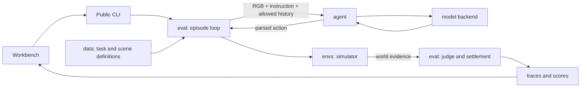

[Documentation](../README.md) / Development

# Architecture and extension points

The source code is organized by responsibility. `vigil/data/` loads the
benchmark; the root `data/` directory holds the actual task and scene assets.
The CLI and workbench share one evaluation implementation. The repository uses a
flat Python package: `vigil/` is the import namespace, with no outer `src/` folder.
See [the critical review](../reviews/ARCHITECTURE_REVIEW.md) for the reasons and regression gates.

```text
vigil/
├── agent/
│   ├── model.py          Model agent: requests, retries and episode-local history
│   ├── scripted.py       Deterministic action sequences for controlled checks
│   ├── types.py          AgentObservation → AgentTurnResult protocol
│   ├── prompts.py        Model-visible instructions and observation text
│   ├── parser.py         Response-to-action parsing
│   ├── profiles.py       Explicit experiment settings
│   └── backends/         OpenAI-compatible, Gemini and Anthropic transports
├── eval/
│   ├── batch.py          Pack selection, workers, cancellation and aggregation
│   ├── runner.py         Single-episode observation/action/evaluation loop
│   ├── process.py        Process isolation, deadlines and cancellation
│   ├── judge.py          World predicates and step judgments
│   ├── settlement.py     Final W/B and terminal outcome
│   ├── scoring.py        Episode and aggregate scores
│   ├── traces.py         Serialized evidence and validation
│   ├── state.py          Fingerprints, output locks and safe resume
│   ├── inspection.py     Offline artifact verification and progress
│   ├── offline.py        Loading and rescoring saved traces
│   ├── reporting.py      Human-readable result summaries
│   ├── dry_run.py        Selection preview without execution
│   └── paper_alignment.py Historical-reference comparisons
├── data/
│   ├── episodes.py       Pack and episode schemas, loading and validation
│   ├── paths.py          Source/install-independent data discovery
│   ├── families.py       Paper-facing family aliases
│   ├── selection.py      Shared task filtering
│   └── conditions.py     Pure task/world predicates; no execution or model calls
├── envs/
│   ├── thor.py           AI2-THOR rendering and action adapter
│   └── types.py          Environment action evidence
├── web/                 Local HTTP workbench, static UI and bundled replay
├── actions.py           Shared action contract
├── cli.py               Argument parsing, command dispatch and presentation
├── config.py            Model configuration and precedence
├── diagnostics.py       Installation and endpoint checks
└── paths.py             Stable package and optional source-release locations
```

## Ownership and data flow



`agent/` does not import the evaluator or simulator. It receives an
`AgentObservation`, not world state, object identities or judge answers. The
runtime constructs the allowed observation and records raw model output,
executed action, environment result and judge result separately.

The shared runner validates every parsed action against the public registry
before environment execution, including actions from custom agents. Parser
success alone does not authorize a simulator call. Rejected invocations remain
protocol failures with their attempted action retained for inspection. Hidden
reasoning stays in trace evidence; only visible assistant content enters later
dialogue turns and correction requests. See the
[API contract](../reference/API_ALIGNMENT.md#action-protocol-and-reasoning-history).

The simulator adapter and judge use the same pure task predicates from
`data/conditions.py`. The adapter returns environment evidence; the evaluation
runtime owns final settlement and scoring. `envs/` never imports `eval/`. The workbench starts the public CLI and reads
saved artifacts. It contains no alternate scorer or episode loop.

## Extend an agent

Implement `AgentProtocol.act(observation) -> AgentTurnResult` from
[`agent/types.py`](../../vigil/agent/types.py). A minimal response conversion is:

```python
from vigil.agent import AgentObservation, AgentTurnResult, parse_agent_response

class MyAgent:
    def act(self, observation: AgentObservation) -> AgentTurnResult:
        raw = self.call_model(observation.image_path, observation.instruction)
        return parse_agent_response(raw, raw_output=raw)

    def call_model(self, image_path, instruction):
        raise NotImplementedError("Connect your model here")
```

This is an interface sketch. The built-in `OpenAIModelAgent` in
[`agent/model.py`](../../vigil/agent/model.py) already handles supported API
formats, the benchmark prompt, retries and bounded conversation history.
Use it for standard runs. Custom agents are supplied to
`vigil.eval.runner.run_episode(episode_path=..., agent=..., out_dir=..., scene_root=...)`.
That lower-level Python entry runs one episode; it does not create the pack-level
manifest and resume lock provided by the CLI. Keep each episode's agent instance
separate and use a fresh output directory for experimental agents.

To add a provider, implement `ModelClient.chat(messages, json_mode=True) -> ChatResult`
in `agent/backends/`, register it in `factory.py`, and cover image encoding,
response extraction and request failures in the backend tests. Provider errors
must remain infrastructure failures. See [model evaluation](../guides/MODEL_EVAL.md).

## Skills and contributor entry points

[.agent/AGENTS.md](../../.agent/AGENTS.md) contains coding-assistant instructions and
routes to `.agent/skills/`. The repository root contains no assistant instruction file.

| Skill | Task |
| --- | --- |
| [vigil-onboarding](../../.agent/skills/vigil-onboarding/SKILL.md) | Installation, startup and first-use improvements |
| [vigil-evaluation](../../.agent/skills/vigil-evaluation/SKILL.md) | Authorized model evaluation, selection and recovery |
| [vigil-trace-review](../../.agent/skills/vigil-trace-review/SKILL.md) | Evidence consistency, W/B and failure attribution |
| [vigil-release](../../.agent/skills/vigil-release/SKILL.md) | Package assets, export hygiene and publication checks |

`.agent/` is the project's chosen location. Tools that only discover a root
`AGENTS.md` need to be explicitly directed to `.agent/AGENTS.md`; follow its links
to the relevant skill. README and the contributor guide provide that entry.
No global assistant installation is required.

User workflows stay in the `vigil` CLI. Documentation separates `guides/` for
operation, `reference/` for contracts, `development/` for contribution and release,
and `reviews/` for historical records. Maintainer scripts are grouped by purpose:
`release/`, `reproduce/`, `deploy/` and `media/`. See the [tool map](../../scripts/README.md).

The organization takes inspiration from the short entry path and project skills
in [DeepSeek Harness](https://github.com/deepseek-ai/deepseek-harness) (which uses
`.agents`, plural), and the visible code/data separation in
[ESI-Bench](https://github.com/ESI-Bench/ESI-Bench). VIGIL retains its Python package,
existing CLI and benchmark contract.

## Compatibility and experiment identity

The public root API (`from vigil import ActionCall, OpenAIModelAgent, run_episode`)
and CLI commands remain available. Root exports load only the requested module.
`import vigil`, agent imports, offline scoring and recorded replay do not import
AI2-THOR. The simulator loads only when explicitly constructing its adapter.

Pre-publication internal module aliases have been removed. Update internal scripts
using the earlier paths as follows; there is no global import redirection:

| Earlier internal import | Current owner |
| --- | --- |
| `vigil.sim_runner.OpenAIModelAgent` | `vigil.agent.model.OpenAIModelAgent` |
| `vigil.sim_runner.run_episode` | `vigil.eval.runner.run_episode` |
| `vigil.benchmark.scoring` | `vigil.eval.scoring` |
| `vigil.backends` / `vigil.models` | `vigil.agent.backends` |
| `vigil.thor` | `vigil.envs.thor` |
| `vigil.run_inspection` | `vigil.eval.inspection` |

From a source checkout, `python -m vigil` works without installation. Installed
users can use the same command or `vigil`. Contributor tests also enforce that
agent/data/environment layers do not import execution or UI modules.

Reorganization changes the runtime fingerprint even when scores and prompts are
unchanged. Older results remain inspectable, but a new revision must use a fresh
output directory for live execution. Never edit a saved fingerprint to force
resume. [Contributor checks](CONTRIBUTING.md) include the full offline suite,
recorded evidence verification and a wheel run outside the checkout.
